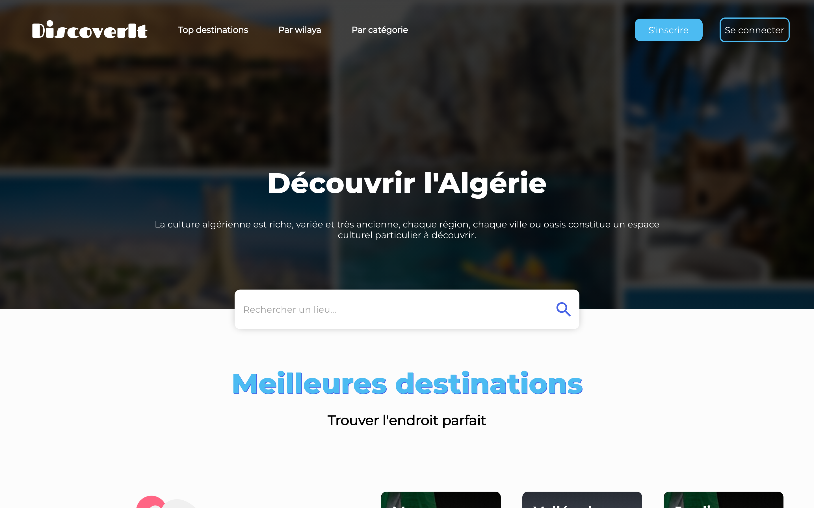
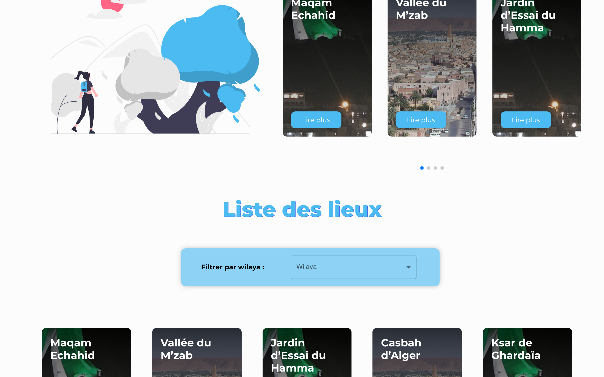
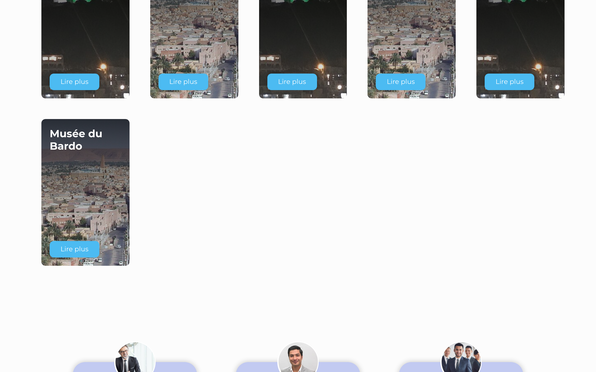

# DiscoverIt

A tourism guide for Algeria: a landing page with a hero search, a carousel of top destinations, a list of places you can filter by wilaya (province), and testimonials. It is the React frontend of a two-part project with an Express and MongoDB API that stores places, their events and media.



| Top destinations | Places filtered by wilaya |
|---|---|
|  |  |


*The API is not running any more, so for these screenshots (November 2026) the page was served six sample places through a mocked `/locations` response; photos of Maqam Echahid and Ghardaïa are from Wikimedia Commons.*

## Features

- Hero with search, and a Swiper carousel of destination cards with "read more" actions.
- A list of places with a multi-select filter over the wilayas, built with Material UI.
- Loading and error states while the places are fetched.
- A testimonials carousel.

## Stack

React (Create React App), Material UI, Swiper, Axios. The API side (Node, Express, TypeScript and MongoDB, with Cloudinary for media) lived in a separate repository.

## Running it

```bash
npm install
npm start      # expects the API at http://localhost:3000/locations
```
